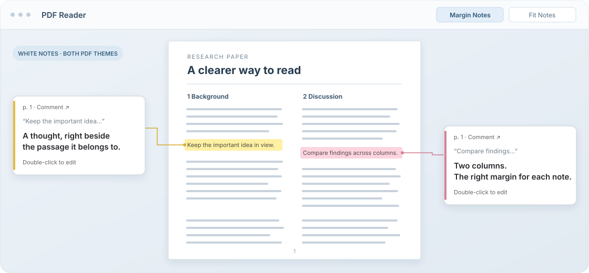

<h1 align="center">Zotero 여백 노트</h1>

<p align="center">PDF 주석 코멘트를 논문 바깥 여백에 띄우고, 두 단 논문에서는 왼쪽/오른쪽 위치를 자동으로 고릅니다.</p>

<p align="center">
  <a href="https://github.com/junhwan26/zotero-margin-notes/actions/workflows/ci.yml"></a>
  <a href="https://github.com/junhwan26/zotero-margin-notes/releases/latest"></a>
  
  <a href="LICENSE"></a>
</p>

<p align="center">
  <a href="README.md">English</a> ·
  <a href="README.ko.md">한국어</a> ·
  <a href="https://github.com/junhwan26/zotero-margin-notes/releases/latest">Download</a> ·
  <a href="#빠른-시작">빠른 시작</a> ·
  <a href="#호환성">호환성</a>
</p>



<p align="center"><sub>개념도입니다. 실제 UI는 Zotero PDF 리더 안에서 현재 PDF 화면 크기에 맞춰 표시됩니다.</sub></p>

## 왜 쓰나

| 기능 | 설명 |
| --- | --- |
| 여백 노트 카드 | PDF 하이라이트·밑줄·메모 주석의 코멘트를 페이지 바깥 흰색 카드로 보여 줍니다. |
| 마크다운 코멘트 | 여백 카드와 추가 코멘트 목록에서 제목, 강조, 목록, 표, 코드, 링크 서식을 표시하고 원본 마크다운을 그대로 수정할 수 있습니다. |
| 두 단 배치 | 주석 좌표, 남은 여백, 주변 카드 혼잡도를 보고 왼쪽 또는 오른쪽 바깥 여백을 고릅니다. |
| 화면에 맞는 카드 너비 | 글자 크기는 유지하면서 남은 바깥 여백을 사용해, 창을 넓히면 한 줄에 더 많은 단어를 표시합니다. |
| Zotero 10 읽기 모드 안전 처리 | Zotero 읽기 모드가 켜진 리더 화면에서는 여백 노트를 잠시 멈추고, PDF 보기로 돌아오면 다시 표시합니다. |
| 기존 리더 동작 보존 | 텍스트 선택, 선택 팝업, 주석 도구, 키보드 선택, 검색, 확대/축소, 페이지 이동, 삭제, 실행 취소/다시 실행, 사이드바 수정을 계속 사용할 수 있습니다. |

## 빠른 시작

1. [최신 릴리스](https://github.com/junhwan26/zotero-margin-notes/releases/latest)에서 `zotero-margin-notes-0.4.1.xpi`를 내려받습니다.
2. Zotero에서 **Tools -> Plugins**를 엽니다.
3. 톱니바퀴 메뉴에서 **Install Plugin From File...**을 누르고 XPI를 선택합니다.
4. PDF를 열고 하이라이트·밑줄·메모 주석에 코멘트를 단 뒤, 리더 도구막대의 **Margin Notes** 또는 **여백 노트**를 사용합니다.

<details>
<summary>0.1.0에서 업그레이드</summary>

`0.1.0` 빌드는 업데이트 주소가 임시 값이었습니다. `0.2.0` 이상을 한 번 수동 설치하면 이후에는 이 저장소의 `updates.json` 릴리스 메타데이터를 사용할 수 있습니다.

</details>

## 조작법

| 동작 | 방법 |
| --- | --- |
| 여백 노트 켜기/끄기 | Zotero PDF 리더 도구막대에서 **Margin Notes** 또는 **여백 노트**를 누릅니다. |
| 노트 공간 만들기 | 창이 좁을 때 **Fit Notes** 또는 **노트에 맞춤**을 누릅니다. 읽기 모드 아래에 숨은 PDF 화면은 확대/축소 대상에서 제외합니다. |
| 일반 텍스트·마크다운 수정 | 여백 노트나 추가 코멘트 목록을 더블클릭합니다. |
| 키보드로 수정 | Tab으로 코멘트에 초점을 맞춘 뒤 **Enter** 또는 **F2**를 누릅니다. |
| 저장 또는 취소 | 인라인 편집기의 **Save/저장** 또는 **Cancel/취소**를 사용합니다. |
| 원래 주석 열기 | 노트 머리글의 페이지 링크를 누릅니다. |

빈 코멘트로 저장하면 해당 카드는 여백 보기에서 사라집니다. 이 플러그인은 코멘트가 있는 주석만 표시합니다. 활성 편집기 안에서 더블클릭하면 일반적인 단어 선택이 유지됩니다. 서식 있는 코멘트는 서식을 일반 텍스트로 잃지 않도록 Zotero 기본 편집기로 넘깁니다.

흰색 노트와 편집창은 밝은·어두운 PDF 테마 모두에서 읽을 수 있습니다. 코멘트는 Zotero 주석에 저장합니다. 기본 화면 언어는 영어이며, 한국어 Zotero에서는 한국어를 자동으로 선택합니다.

카드는 글자를 키우지 않고 남은 바깥 여백만큼 넓어집니다. 왼쪽과 오른쪽의 실제 너비로 높이를 각각 측정하므로 넓은 노트는 한 줄에 더 많은 단어를 표시하면서 PDF와 주변 카드를 피합니다. 창 크기를 바꿔도 저장 전 편집 초안, 편집창 초점, 편집창에서 선택한 텍스트를 보존합니다.

## 마크다운 코멘트

주석 코멘트에 마크다운을 입력하면 여백 카드와 추가 코멘트 목록에 서식을 적용해 보여 줍니다.

```markdown
# 핵심 아이디어
**중요:** 두 방법을 비교하기.

- 기준 결과 확인하기
- `evaluate()` 다시 실행하기

[논문 노트](https://www.zotero.org/)
```

코멘트를 더블클릭하면 원본 마크다운을 수정할 수 있고, 저장하면 다시 서식이 적용된 모습으로 표시됩니다. Zotero 주석 사이드바와 여백 노트는 같은 코멘트를 사용하므로 수정 내용도 함께 반영됩니다. 기존 서식 있는 코멘트는 계속 Zotero 기본 편집기로 엽니다.

작업 표시, 인용문, 표도 지원합니다. 안전한 주소의 링크는 PDF 리더 밖에서 엽니다. 임의 HTML은 실행하지 않고 이미지 문법은 글자 그대로 표시합니다. 기존 Zotero 서식 태그는 호환 표시 변환을 적용하고 계속 기본 편집기를 사용하며, 마크다운 코드 속 HTML은 원문 그대로 남습니다. 간단한 마크다운 문법을 지원하며 전체 CommonMark 규격이나 수식 표기는 지원하지 않습니다.

## 호환성

Margin Notes는 필수로 설치해야 하는 다른 Zotero 플러그인이 없고, npm 런타임 패키지 의존성도 없습니다. 대상은 Zotero `9.0`부터 `10.0.*`까지이며, Zotero `9.0.6`과 `10.0.6` 실제 앱에서 검증했습니다. PDF 전용 플러그인이므로 EPUB와 웹 스냅샷에는 적용되지 않습니다.

`0.4.1` 빌드는 2026-10-26 macOS에서 **Node 검사 49/49개**, **독립 Zotero 9.0.6 검사 292/292개**, **독립 Zotero 10.0.6 검사 309/309개**를 통과했습니다. 글자 크기를 유지하는 줄바꿈, 안전한 배치, 편집 초안·초점·선택 영역 보존과 기존 리더 동작을 확인했습니다. [0.4.1 공개 검사 요약](docs/evidence/compatibility-0.4.1.json)과 [호환성 기록](docs/compatibility.ko.md)에서 확인할 수 있습니다.

과거 `0.4.0` 검증은 2026-10-26 macOS에서 **Node 검사 44/44개**, **독립 Zotero 9.0.6 검사 271/271개**, **독립 Zotero 10.0.6 검사 288/288개**, 문법 검사, diff 검사, XPI 빌드를 통과했습니다. 당시 실제 앱 검사는 마크다운 표시·원본 편집, 사이드바 동기화, HTML·이미지·위험한 링크의 비활성 처리, 기존 서식과 코드가 섞인 코멘트, 기존 리더 동작을 확인했습니다. [0.4.0 공개 검사 요약](docs/evidence/compatibility-0.4.0.json)을 유지합니다. 아래 다른 플러그인 관찰도 과거 기록입니다.

`0.3.1` 릴리스는 표시 대상을 하이라이트와 밑줄에서 Zotero 메모 주석까지 확장합니다. 메모 주석에는 선택된 원문 인용문이 없으므로 여백 카드는 인용문 영역을 숨기고 주석 코멘트만 보여 줍니다.

과거 `0.3.1` 검증 기록: 해당 빌드는 Node 검사 26개, 업데이트 정보 확인, 문법 검사, diff 검사, 재현 가능한 빌드, Zotero `9.0.6` 실제 앱 검사 246/246개, Zotero `10.0.6` 실제 앱 검사 263/263개를 통과했습니다. 당시 0.3.1 XPI와 Zotero 10.0.6에 설치해 검사한 파일의 SHA-256은 모두 `9648934bc1566ac7557bd6701ec54288c786a6ec02aa2752e749ecfc7db6922f`였습니다. 로컬 Zotero 10.0.6 UI에서 Margin Notes 0.3.1 활성 상태를 확인했고, 기존 Zotero 메모 주석이 있는 실제 PDF 7쪽에서 접근성 트리를 통해 노트 카드 2개가 보이는 것을 확인했습니다. 이는 0.3.1에 관한 관찰 기록입니다. 의존성 감사, 검사 목록, 다른 플러그인의 활성화 상태는 [호환성 검사 기록](docs/compatibility.ko.md)과 [0.3.1 공개 검사 요약](docs/evidence/compatibility-0.3.1.json)에서 확인할 수 있습니다.

과거 `0.3.0` 근거는 [0.3.0 공개 검사 요약](docs/evidence/compatibility-0.3.0.json)에 남겨 두었습니다.

과거 `0.2.3` 근거도 유지합니다. `0.2.3`은 [Zotero 9.0.6 실제 검사 218개](https://github.com/junhwan26/zotero-margin-notes/actions/runs/37580613959)와 Node 테스트 23개를 통과했습니다. 2026-10-07 Better BibTeX, Translate for Zotero, Ethereal Style, Research Vault Bridge, 비활성 ZotMoov 관찰 기록은 Zotero 9.0.6 시기의 로컬 설치 상태이며, Zotero 10 통합 인증이 아닙니다.

## 지원

문제가 있으면 [GitHub issue](https://github.com/junhwan26/zotero-margin-notes/issues)에 Zotero 버전, 플러그인 버전, 운영체제, 재현 절차, 읽기 모드 활성 여부, 그리고 Margin Notes만 켰을 때도 같은 문제가 나는지 적어 주세요. Zotero 리더의 내부 동작은 버전에 따라 바뀔 수 있어서 정확한 버전 정보가 중요합니다.

## 참고한 문서

README 구성은 공개 Zotero 플러그인 문서인 [Zotero PDF Translate](https://github.com/windingwind/zotero-pdf-translate/blob/main/README.md), [Better Notes for Zotero](https://github.com/windingwind/zotero-better-notes/blob/master/README.md), [Zotero Style](https://github.com/MuiseDestiny/zotero-style/blob/master/README.md), [Better BibTeX](https://github.com/retorquere/zotero-better-bibtex/blob/master/README.md)를 참고했습니다. 이는 문서 구조 참고이며, 해당 프로젝트의 보증이나 호환성 주장으로 해석하면 안 됩니다.

<details>
<summary>개발</summary>

이 저장소에는 npm 런타임 의존성이 없습니다. 개발에는 Node.js 기반 단위·문법 검사와 Python 3 기반 재현 가능한 XPI 빌드를 사용합니다.

```sh
npm test
npm run check
npm run build
```

실제 Zotero 회귀 검사는 임시 프로필, 합성 PDF, 검사 대상 Zotero 앱을 사용합니다. CI는 공식 Zotero 릴리스 호스트에서 Zotero `9.0.6`과 `10.0.6`을 내려받고 각 DMG SHA-256을 확인한 뒤 검사 환경의 임시 폴더에 설치합니다. 실행 결과는 Zotero 버전별 `runtime-smoke-report` 결과 파일로 업로드됩니다. 현재 CI 구성은 [Check workflow](https://github.com/junhwan26/zotero-margin-notes/actions/workflows/ci.yml)에서 확인할 수 있습니다.

Zotero의 [Zotero 10 for Developers](https://www.zotero.org/support/dev/zotero_10_for_developers) 안내는 호환성을 확인한 뒤 `strict_max_version`을 `10.0.*`로 올리라고 설명합니다. 자동 검사는 선언한 지원 범위를 Zotero `9.0.6`과 `10.0.6`에서 검사하는 방식으로 이 이전 작업을 따릅니다.

</details>
