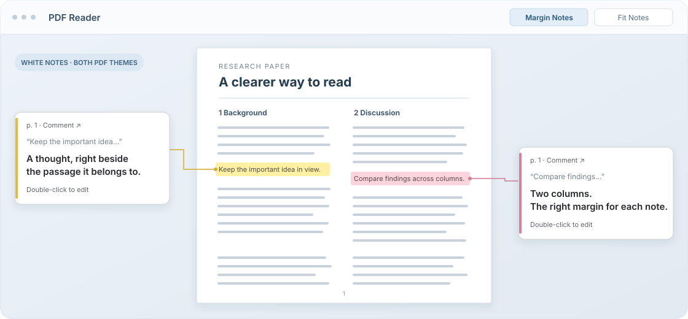

<h1 align="center">Margin Notes for Zotero</h1>

<p align="center">Read and edit PDF annotation comments in the left or right outer margin, chosen automatically for two-column papers.</p>

<p align="center">
  <a href="https://github.com/junhwan26/zotero-margin-notes/actions/workflows/ci.yml"></a>
  <a href="https://github.com/junhwan26/zotero-margin-notes/releases/latest"></a>
  
  <a href="LICENSE"></a>
</p>

<p align="center">
  <a href="README.md">English</a> ·
  <a href="README.ko.md">한국어</a> ·
  <a href="https://github.com/junhwan26/zotero-margin-notes/releases/latest">Download</a> ·
  <a href="#quick-start">Quick Start</a> ·
  <a href="#compatibility">Compatibility</a>
</p>



<p align="center"><sub>Conceptual illustration. The real UI appears inside Zotero's PDF reader and follows the current PDF viewport.</sub></p>

## Why Use It

| Feature | What it does |
| --- | --- |
| Margin note cards | Shows comments from highlights, underlines, and note annotations as white cards outside the page. |
| Markdown comments | Formats headings, emphasis, lists, tables, code, and links in margin cards and overflow comments while keeping the original Markdown editable. |
| Two-column placement | Chooses the left or right outer margin from annotation coordinates, available room, and nearby card congestion. |
| Responsive card width | Uses the available outer margin at the same text size, fitting more words per line as the window grows. |
| Add notes in the margin | Select a highlight that has no comment yet and write one from its margin card. |
| Formulas | Renders `$…$` and `$$…$$` as math with a bundled KaTeX; anything it cannot parse stays visible as TeX. |
| Settings | Text size, card width, margin side, card color, quotes, connector lines, and more under **Settings -> Margin Notes**. |
| Zotero 10 Reading Mode safety | Suspends margin notes per reader pane while Zotero Reading Mode is active, then resumes when the pane returns to PDF view. |
| Zotero workflow preservation | Keeps text selection, selection popups, annotation tools, keyboard selection, search, zoom, page navigation, deletion, undo/redo, and sidebar edits working. |

## Quick Start

1. Download `zotero-margin-notes-0.5.0.xpi` from the [latest release](https://github.com/junhwan26/zotero-margin-notes/releases/latest).
2. In Zotero, open **Tools -> Plugins**.
3. Open the gear menu, choose **Install Plugin From File...**, and select the XPI.
4. Open a PDF, add a comment to a highlight, underline, or note annotation, then use **Margin Notes** in the reader toolbar.

<details>
<summary>Upgrading from 0.1.0</summary>

The `0.1.0` build used a placeholder update URL. Install `0.2.0` or later manually once; after that, Zotero can use this repository's `updates.json` release metadata.

</details>

## Gestures

| Action | Gesture |
| --- | --- |
| Toggle margin notes | Click **Margin Notes** in the Zotero PDF reader toolbar, or press **Alt+M** (**⌥M** on macOS). |
| Add a comment | Select a highlight, underline, or note without a comment, then click **+ Add a note** on its card. |
| Make room for notes | Click **Fit Notes** when the window is too narrow; hidden Reading Mode PDF panes are ignored. |
| Edit plain text or Markdown | Double-click a margin note or overflow comment. |
| Keyboard edit | Focus the comment with Tab, then press **Enter** or **F2**. |
| Save or cancel | Use **Save** or **Cancel** in the inline editor, or **Ctrl/⌘+Enter** and **Esc**. |
| Open the source annotation | Click the page link in a note header. |

Saving an empty comment removes that card from the margin view: the plugin displays annotations that contain comments, plus the selected annotation so you can add one. Double-clicking inside an active editor keeps normal word selection. Comments containing rich text delegate to Zotero's native editor instead of flattening formatting.

Notes are white in both PDF themes by default; **Settings -> Margin Notes -> Card color** can match the PDF theme or stay dark. Comments are saved in Zotero annotations. English is the default interface language; Korean Zotero locales select Korean automatically.

Cards expand into the available outer margin without enlarging the text. Each side is measured at its actual width, so wider notes fit more words per line while placement keeps clear of the PDF and neighboring cards. Resizing preserves unsaved editor drafts, focus, and selected editor text.

## Settings

Open Zotero's **Settings** and choose **Margin Notes**. Changes apply to open PDFs immediately.

| Setting | Default | Options |
| --- | --- | --- |
| Text size | 13 px | 11–18 px |
| Maximum card width | Whole margin | 160–520 px |
| Margin | Nearest side | Left only, right only |
| Card color | Always white | Match the PDF theme, always dark |
| Highlighted text above the comment | On | Off |
| Line from note to annotation | On | Off |
| Long comments | Scroll inside the card | Show in full |
| Add a note from a selected annotation | On | Off |
| Hide Zotero's comment popup when the margin card shows the same annotation | On | Off |
| Formulas | On | Off |
| Alt+M shortcut | On | Off |

## Markdown Comments

Write Markdown in an annotation comment to see it formatted in the margin card and overflow list:

```markdown
# Key idea
**Important:** compare both methods.

- Check the baseline
- Run `evaluate()` again

[Paper notes](https://www.zotero.org/)
```

Double-click a comment to edit its original Markdown, then save to return to the formatted view. Edits in Zotero's annotation sidebar and margin notes use the same comment and stay in sync. Existing rich-text comments still open Zotero's native editor.

Task markers, blockquotes, and tables are also supported. Links with safe URLs open outside the PDF reader. Arbitrary raw HTML is not executed, and image syntax remains literal text. Existing Zotero rich-text tags receive compatible display conversion and still use Zotero's native editor; HTML inside Markdown code stays literal. This is a compact Markdown subset; full CommonMark is not supported.

Formulas use TeX between dollar signs: `$E = mc^2$` inline, `$$\sum_i x_i$$` on its own line. A dollar sign followed by a space or a closing one followed by a digit stays ordinary text, so `$5 or $10` is not a formula. Formulas are drawn as MathML by a bundled [KaTeX](https://katex.org/) 0.16.22 (MIT); no fonts or network access are involved.

## Compatibility

Margin Notes has no required third-party Zotero add-on and no npm package dependency; KaTeX is bundled in the XPI. It targets Zotero `9.0` through `10.0.*`. The plugin is PDF-only; EPUB and web snapshots are ignored.

| Version | Node tests | Zotero 9.0.6 | Zotero 10.0.6 | Zotero 10.0.9 |
| --- | --- | --- | --- | --- |
| `0.5.0` | 74/74 passed | 324/324 passed | 341/341 passed | 340/340 passed |
| `0.4.2` | 56/56 passed | 294/294 passed | 311/311 passed | — |

`0.5.0` adds settings, formulas, adding notes from the margin, and a refreshed card design. Its native regression suite passed 340/340 checks on macOS with Zotero `10.0.9` on 2026-11-11, preserving all 310 baseline checks and adding 30 checks for the new features. GitHub CI then passed the same suite on Zotero `9.0.6` (324/324) and `10.0.6` (341/341); Zotero 10-only checks such as Reading Mode are skipped on 9.0.6. Per-version results, artifact hashes, and the dependency audit are in the [compatibility record](docs/compatibility.md) and [`docs/evidence`](docs/evidence).

## Support

Open a [GitHub issue](https://github.com/junhwan26/zotero-margin-notes/issues) with your Zotero version, plugin version, operating system, a small reproduction, whether Reading Mode was active, and whether the problem still happens with only Margin Notes enabled. Reader internals can change between Zotero releases, so exact version details matter.

## Acknowledgments

The README structure was informed by public Zotero plugin documentation from [Zotero PDF Translate](https://github.com/windingwind/zotero-pdf-translate/blob/main/README.md), [Better Notes for Zotero](https://github.com/windingwind/zotero-better-notes/blob/master/README.md), [Zotero Style](https://github.com/MuiseDestiny/zotero-style/blob/master/README.md), and [Better BibTeX](https://github.com/retorquere/zotero-better-bibtex/blob/master/README.md). This is a documentation reference, not an endorsement or compatibility claim.

<details>
<summary>Development</summary>

This repository has no npm dependencies. KaTeX is vendored as `vendor/katex.min.js` and loaded only for formula rendering; every use of Zotero's unpublished reader internals is isolated in `src/reader.js`. Development uses Node.js for unit tests and syntax checks, and Python 3 for the reproducible XPI build.

```sh
npm test
npm run check
npm run build
```

Native Zotero smoke tests use a temporary profile, a synthetic PDF, and the Zotero app under test. CI downloads Zotero `9.0.6` and `10.0.6` from the official Zotero release host, verifies each DMG SHA-256, installs Zotero into the runner's temporary directory, and uploads one `runtime-smoke-report` artifact per Zotero version. See the [Check workflow](https://github.com/junhwan26/zotero-margin-notes/actions/workflows/ci.yml) for the current CI setup.

Zotero's [Zotero 10 for Developers](https://www.zotero.org/support/dev/zotero_10_for_developers) guide says plugins should update `strict_max_version` to `10.0.*` after confirming compatibility. The current CI matrix follows that migration by testing the declared manifest range against Zotero `9.0.6` and `10.0.6`.

</details>
